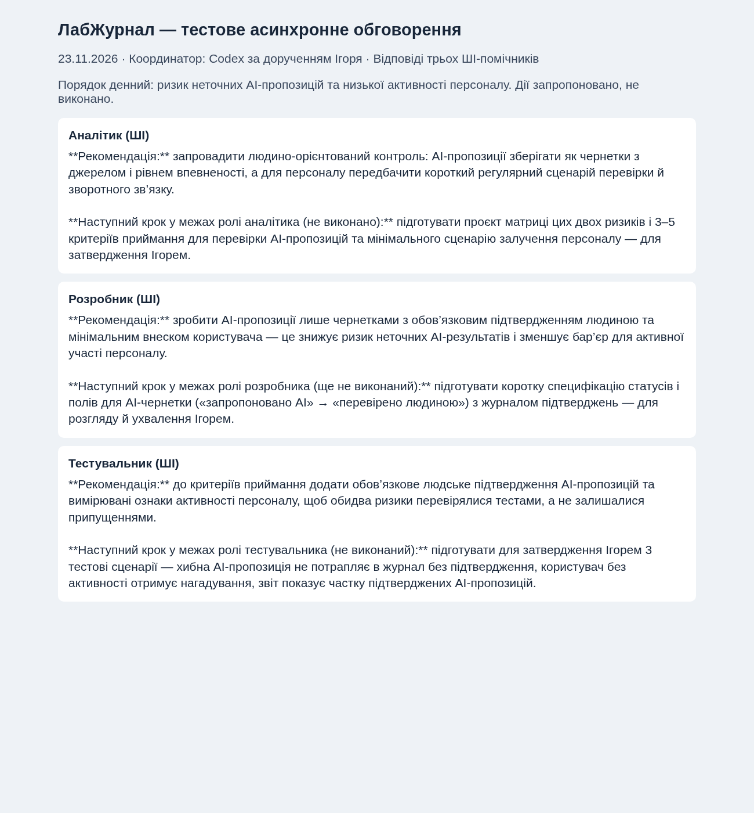

# Лабораторна робота №4

## Мета роботи

Опрацювати управління ризиками, кадровим забезпеченням і комунікаціями
проєкту: скласти реєстр ризиків (Risk Register) із кількісною оцінкою та
планом реагування, побудувати матрицю RACI, встановити регламент
комунікацій і підготувати простір проєкту з онбордінг-сторінкою, зокрема
навчанням науковців роботі з допоміжними (AI) модулями системи «ЛабЖурнал».

## Завдання

1. За допомогою інструментів Confluence, Notion створити простір проєкту.
2. Скласти Risk Register на 5 ризиків (ймовірність, вплив, стратегія).
3. Побудувати матрицю RACI з реальними прізвищами членів команди.
4. Для Risk Register прорахувати кількісний Risk Score і написати детальний
   Action Plan (Mitigation) для топ-2 ризиків.
5. Провести тестовий командний мітинг і написати Meeting Notes із реальними
   Action items.
6. Створити технічну Onboarding-сторінку з інструкцією по розгортанню
   локального середовища і посиланнями на репозиторій.

Ризики взято з пунктів 17–18 паспорта проєкту (лабораторна робота №1),
індикатори контролю — з пункту 18. Проєктна команда — одна особа, Авраменко
Ігор (рішення про склад команди — в паспорті, пункт 11).

## Хід роботи

### 1. Реєстр ризиків (Risk Register)

Планування ризиків виконано за кроками теорії: ідентифікація ризиків,
оцінка ризиків, розробка заходів реагування. Ідентифіковані ризики R1–R8
наведено в пункті 17 паспорта; до реєстру відібрано 5 ризиків із найбільшою
оцінкою. Кожен ризик оцінено за двома параметрами з п'ятьма рівнями:
ймовірність настання (1 — малоймовірно, 5 — майже напевно) та вплив на мету
проєкту (1 — незначний, 5 — критичний). Кількісна оцінка — Risk Score —
дорівнює добутку ймовірності на вплив (діапазон 1–25). Стратегії взято з
напрямків боротьби з ризиками: уникнення ризику, переадресування ризику,
погодження з наявністю ризику; заходи зниження — з методів зниження ризиків
(резервування, розподіл).

| Код | Ризик (паспорт, п. 17) | Ймовірність | Вплив | Risk Score | Стратегія | Індикатор контролю (п. 18) |
|---|---|---|---|---|---|---|
| R4 | Помилкові пропозиції допоміжних модулів | 4 | 4 | 16 | Погодження з наявністю; зниження — обов'язкова перевірка науковцем | K4 (помилки в звітах), частка прийнятих пропозицій |
| R1 | Низька залученість науковців, опір новому | 3 | 5 | 15 | Погодження з наявністю; зниження — пілот однієї групи, навчання | K3 (щотижнева активність ≥ 80 %) |
| R5 | Зрив термінів через навантаження виконавця | 3 | 4 | 12 | Погодження з наявністю; резервування часу, пріоритети MoSCoW | віхи В1–В7 графіка |
| R2 | Дані розпорошені, складна міграція | 3 | 3 | 9 | Уникнення — обмеження обсягу міграції; зниження — поетапне перенесення | K1 (повторюваність дослідів) |
| R3 | Нестабільність зовнішніх AI-сервісів | 3 | 2 | 6 | Погодження з наявністю; зниження — резервний режим без допоміжних модулів | доступність допоміжних модулів у журналі системи |

Якісний аналіз (опис ризиків і наслідків) — у колонці «Ризик» і в пункті 17
паспорта; кількісний — у вигляді Risk Score. Реєстр переглядається на кожній
вісі проєкту; нові ризики додаються тим самим порядком.

### 2. Action Plan (Mitigation) для топ-2 ризиків

**R4 — помилкові пропозиції допоміжних модулів (Risk Score 16).** Наслідок:
хибні дані в протоколах і звітах, втрата довіри до системи. Заходи:

| # | Захід (Mitigation) | Відповідальний | Строк | Критерій завершення |
|---|---|---|---|---|
| 1 | Механізм затвердження пропозицій у системі: пропозиція має статус «чернетка» і вноситься до записів лише після дії «Затвердити» | Авраменко Ігор (розробник) | 30.04.2027 (віха В4) | кожна пропозиція має позначку модуля і підтвердження науковця |
| 2 | Журнал пропозицій допоміжних модулів: що запропоновано, прийнято чи відхилено | Авраменко Ігор (розробник) | 30.04.2027 (В4) | журнал переглядається адміністратором |
| 3 | Вимірювання частки прийнятих пропозицій під час пілота; якщо менш як 50 % — модуль вимикається до доопрацювання | Авраменко Ігор (керівник проєкту) | 02.07.2027 (В6) | значення частки зафіксовано в оцінці пілота |
| 4 | Навчання науковців критичному опрацюванню пропозицій (розділ онбордінг-сторінки) | Авраменко Ігор (аналітик) | 27.08.2027 (В7) | розділ опубліковано, семінар проведено |
| 5 | Резерв: основні функції F1–F6 працюють без допоміжних модулів | Авраменко Ігор (розробник) | постійно | резервний режим описано в прототипі (див. LR2, діаграма послідовностей) |

**R1 — низька залученість науковців (Risk Score 15).** Наслідок: пілот без
користувачів, хибні вимоги, недосягнення цілей C3–C5. Заходи:

| # | Захід (Mitigation) | Відповідальний | Строк | Критерій завершення |
|---|---|---|---|---|
| 1 | Пілот однієї дослідницької групи (3–5 науковців) замість впровадження на всю лабораторію | Авраменко Ігор (керівник проєкту) | 02.07.2027 (В6) | група веде роботу в системі 4 тижні поспіль |
| 2 | Погодження участі пілотної групи (2–3 год на тиждень) із керівником лабораторії | Авраменко Ігор (керівник проєкту) | 18.12.2026 (В1) | перелік учасників пілота зафіксовано |
| 3 | Простий інтерфейс без спеціального навчання; прототипи — на узгодження пілотній групі | Авраменко Ігор (аналітик) | 29.01.2027 (В2) | прототип узгоджено на етапній зустрічі |
| 4 | Семінари, онбордінг-сторінка, короткі інструкції та швидкі підказки в системі | Авраменко Ігор (аналітик) | 27.08.2027 (В7) | матеріали опубліковано, семінари проведено |
| 5 | Моніторинг K3 (щотижнева активність); менш як 50 % два тижні поспіль — зустріч із керівником лабораторії і перегляд процесу | Авраменко Ігор (керівник проєкту) | щотижня під час пілота | значення K3 у звіті пілота |
| 6 | Резерв: можливість продовжити пілот у межах етапу 7, перенісши розгортання решти напрямів | Авраменко Ігор (керівник проєкту) | за потребою | рішення зафіксовано в реєстрі змін |

### 3. Матриця RACI

RACI розподіляє для кожної діяльності ролі: R (responsible) — виконує,
A (accountable) — відповідає і приймає рішення, C (consulted) — консультує,
I (informed) — інформується. Проєктна команда проєкту «ЛабЖурнал» — одна
особа: **Авраменко Ігор**, який виконує ролі керівника проєкту, аналітика
вимог, розробника і тестувальника (паспорт, пункт 11). Матриця фіксує початковий розподіл ролей на 09.11.2026. 23.11.2026 до
команди додано ШІ-помічників; оновлений розподіл подано нижче.

| Діяльність | Керівник проєкту | Аналітик вимог | Розробник | Тестувальник |
|---|---|---|---|---|
| Планування проєкту, графік, віхи | A, R | I | I | I |
| Аналіз вимог, реєстр вимог | A | R | C | C |
| Концептуальне проектування | A | C | R | C |
| Реалізація ядра системи (F1–F5, F8) | A | C | R | I |
| Допоміжні модулі та база знань (F6–F7) | A | C | R | I |
| Тестування, приймальні перевірки | A | I | C | R |
| Управління ризиками, реєстр ризиків | A, R | C | C | C |
| Комунікації із замовником, звітність | A, R | C | I | I |
| Навчання персоналу, онбордінг | A | R | C | I |
| Адміністрування системи, резервні копії | A | I | R | I |

Початково всі чотири колонки позначали одну людину — Авраменка Ігоря.
Після створення помічників для подальшої роботи використовується такий
розподіл:

| Діяльність | Ігор (PM) | Аналітик (ШІ) | Розробник (ШІ) | Тестувальник (ШІ) |
|---|---|---|---|---|
| Планування і рішення | A, R | C | C | C |
| Уточнення вимог | A | R | C | C |
| Проєктні пропозиції | A | C | R | C |
| Тестові сценарії | A | C | C | R |
| Перевірка і прийняття результатів | A, R | C | C | C |

ШІ-помічники — програмні засоби, а не студенти; R означає підготовку
пропозицій у межах доручення. Остаточна відповідальність і перевірка — за
Ігорем. Початкова робота та зустріч 09.11.2026 виконувались без цих помічників.

### 4. Регламент комунікацій

Управління комунікаціями проєкту охоплює чотири процеси за теорією:
планування системи комунікацій, збір і розподіл інформації, звітність про хід
виконання проєкту, документування ходу робіт. План комунікацій визначає
джерела інформації (замовник, пілотна група науковців, система «ЛабЖурнал»),
її споживачів і способи доставки. Види комунікацій проєкту: внутрішні
(всередині команди) і зовнішні (із замовником — керівником лабораторії);
формальні (звіти, наради) і неформальні (нагадування, обговорення);
письмові та усні.

| Що | Коли | Форма | Учасники | Документ |
|---|---|---|---|---|
| Статус-огляд ходу робіт | щопонеділка | письмово (дошка планування + короткий статус) | керівник проєкту, замовник | статус-огляд |
| Нарада з замовником (тестова командна зустріч) | щотижня та на віхах | усна (очно/онлайн) + протокол | керівник проєкту, замовник, пілотна група | Meeting Notes |
| Звіт етапу (віхи В1–В7) | на віху | письмовий звіт + демонстрація результату | керівник проєкту, замовник | звіт етапу |
| Запит на зміну обсягу | за потребою | письмово, фіксація в реєстрі | ініціатор, керівник проєкту, замовник | реєстр змін |
| Питання науковців пілота | протягом робочого дня | месенджер або пошта, відповідь — у базу знань | науковці, керівник проєкту | стаття бази знань |
| Інцидент системи (збій, помилка модуля) | негайно | письмово адміністратору | користувачі, адміністратор | журнал інцидентів |

Звітність про хід виконання містить поточний стан робіт, відхилення від
базових планів (паспорт, пункт 21) і прогноз завершення. Документування
ходу робіт передбачає збір і верифікацію даних, аналіз ступеня досягнення
результатів та архівування документів проєкту.

**Meeting Notes (зустріч із планування проєкту, 09.11.2026).** Учасник:
Авраменко Ігор (керівник проєкту). Порядок денний: концепція і паспорт
проєкту; вимоги та історії користувача; планування в інструменті
управління проєктами; ризики, комунікації, онбордінг. Реальні Action items:

| # | Дія | Відповідальний | Строк | Статус |
|---|---|---|---|---|
| 1 | Скласти паспорт проєкту «ЛабЖурнал» (21 пункт) | Авраменко Ігор | 09.11.2026 | виконано |
| 2 | Описати акторів, прецеденти, 10 історій користувача, RTM | Авраменко Ігор | 09.11.2026 | виконано |
| 3 | Видалити стару дошку планування, створити дошку «ЛабЖурнал — планування» | Авраменко Ігор | 09.11.2026 | виконано |
| 4 | Запланувати 10 задач (ITP-10…ITP-19) із дедлайнами віх | Авраменко Ігор | 09.11.2026 | виконано |
| 5 | Скласти реєстр ризиків і Action Plan для топ-2 | Авраменко Ігор | 09.11.2026 | виконано |
| 6 | Підготувати регламент комунікацій і онбордінг-сторінку | Авраменко Ігор | 09.11.2026 | виконано |
| 7 | Погодити участь пілотної групи з керівником лабораторії | Авраменко Ігор | 18.12.2026 (В1) | заплановано |
| 8 | Розпочати інтерв'ю з науковцями (етап 1) | Авраменко Ігор | 16.11.2026 | заплановано |

Зустріч проведено як робочу сесію планування: проєктна команда — одна
особа, тому фотофіксація чи скрін відеозустрічі не створювалися; протокол
вище фіксує реальні рішення та Action items сесії. Шаблон Meeting Notes для
нарад із замовником (у межах регламенту): дата, учасники, порядок денний,
рішення, Action items (дія, відповідальний, строк, статус).

**Тестове асинхронне обговорення з ШІ-помічниками (23.11.2026).**
Координатор — Codex за дорученням Ігоря; окремо опитано трьох помічників
Pi Durable: аналітика, розробника та тестувальника. Це асинхронна робоча
сесія, а не відеодзвінок і не зустріч студентів. Порядок денний — ризики
неточних AI-пропозицій та низької активності персоналу. Відповіді отримано
з розгорнутої системи; координатор сформував знімок сторінки з їхнім текстом.

Спільна рекомендація — залишати AI-пропозиції чернетками з перевіркою
людиною та врахувати залучення користувачів. Запропоновані дії зареєстровано
в Linear; виконання й затвердження не підтверджено.

| Дія | Роль | Задача Linear | Стан |
|---|---|---|---|
| Підготувати критерії перевірки AI-пропозицій і сценарій залучення | Аналітик (ШІ) | IHO-23 | Backlog |
| Запропонувати статуси та поля AI-чернетки | Розробник (ШІ) | IHO-24 | Backlog |
| Підготувати сценарії людської перевірки | Тестувальник (ШІ) | IHO-25 | Backlog |

Авраменко Ігор не зазначений як учасник цієї конкретної сесії: розмову
скоординовано за його дорученням. Це знімок запису відповідей, не скрін
відеозустрічі; відповідність такої форми умові про командний мітинг має
оцінити викладач.

### 5. Простір проєкту та Onboarding-сторінка

23.11.2026 створено простір [«ЛабЖурнал» у Notion](https://app.notion.com/p/421892e35d978073bbb2db0fc3bba6c5) і перевірено наявність чотирьох сторінок:

- [Опис проєкту](https://app.notion.com/p/421892e35d9781ad9021d8f5c12556e6) із посиланням на план у Linear;
- [Ризики і відповідальність](https://app.notion.com/p/421892e35d9781008285fc4517c0fc2a) — реєстр ризиків, заходи та RACI;
- [Комунікації та зустрічі](https://app.notion.com/p/421892e35d978150b0d0c30f9415225a) — регламент і записи сесій;
- [Onboarding — середовище і доступи](https://app.notion.com/p/Onboarding-421892e35d978189b229fafc703e2f2d) — інструкція для наявних ШІ-помічників, посилання на дошку та навчальні рекомендації.

Технічний онбордінг описує саме наявний код помічників: відкрити
`courses/it-pm/lab4`, виконати `npm ci` та `npm run check`; розгортання
потребує авторизованого Wrangler і секретів `ACCESS_TOKEN` та `LINEAR_KEY`.
Ключі в Notion і звіт не додаються. Доступ до помічників здійснюється через
браузер за окремим ключем. Навчальна рекомендація — перевіряти кожну
AI-пропозицію людиною перед використанням.

Сама система «ЛабЖурнал» наразі лише планується: репозиторію продукту немає,
тому посилання на нього та перевіреної інструкції його локального розгортання
немає. Цю частину онбордінгу потрібно доповнити після створення продукту.
Сторінки створені з підготовлених матеріалів через API Notion; повторна
перевірка підтвердила їхню наявність.

### 6. ШІ-помічники проєкту на Cloudflare Workers

23.11.2026 розгорнуто три окремі розмови Pi Durable: **Аналітик** (вимоги),
**Розробник** (проєктні пропозиції) і **Тестувальник** (перевірки). Керівник
проєкту формулює завдання та перевіряє відповіді. Для планування задач
проєкту використовується Linear. Реалізовано інструмент GraphQL для доступу
до Linear через секрет `LINEAR_KEY`. 23.11.2026 тестовий запит `viewer`
успішно повернув користувача `ihor`. У новому обліковому записі створено проєкт
[«ЛабЖурнал — планування»](https://linear.app/ihor-av/project/labzhurnal-planuvannya-fdb711cf52dd)
і задачі IHO-5–IHO-14 за US1–US10 лабораторної №2. Перевірка читанням
підтвердила 10 задач із пріоритетами та строками з плану лабораторної №3;
усі мають початковий стан Backlog. Попередня дошка належала іншому
обліковому запису. Помічники не мають доступу до репозиторію.

Cloudflare Workers обробляє запит, перевіряє ключ доступу і передає його
окремому Durable Object за назвою ролі. PiHarness зберігає історію та стан
розмови в SQLite Durable Object; модель Workers AI формує відповідь. 23.11.2026
перевірено запити до всіх трьох ролей: кожна повернула відповідь HTTP 200.
Це перевірка доступності помічників, а не підтвердження виконання ними
проєктних завдань. Адреса: [Команда ЛабЖурнал](https://labzhurnal-personnel.hackaton-scope-creep.workers.dev/).

Нижче наведено реалізацію Pi Durable та обробника запитів; HTML-інтерфейс
міститься в `src/page.js`, конфігурація розгортання — у `wrangler.jsonc`.
Ключ зберігається як секрет Cloudflare, його не включено до звіту.

[Реалізація Pi Durable та маршруту запитів](src/index.js#L1-)

[Інструмент доступу до Linear](src/linear.js#L1-)

Інструмент виконує запити та мутації від імені власника ключа відповідно до
наданих ключу прав; автоматичне повторення після переривання вимкнено, щоб
не повторювати зміни. Секрет не входить до вихідного коду чи звіту.

Джерела: [Cloudflare: Pi harness](https://developers.cloudflare.com/agents/harnesses/pi/),
[Earendil: Pi Durable](https://earendil.com/posts/pi-durable/).

## Результати

Складено Risk Register із 5 ризиків (джерело — пункти 17–18 паспорта) з
ймовірністю, впливом і стратегією; прораховано кількісний Risk Score
(топ-2: R4 — 16 балів, R1 — 15 балів) і написано детальний Action Plan
(Mitigation) для цих двох ризиків. Побудовано матрицю RACI на 10 діяльностей
і початкові 4 ролі; згодом додано три ШІ-помічники для подальшої роботи.
Встановлено регламент комунікацій (6 типів комунікацій, план збору й
розподілу інформації, звітність, документування) та зафіксовано Meeting
Notes із реальними Action items. У Notion створено чотири сторінки проєкту,
включно з онбордінгом для наявних помічників. Продуктового репозиторію та
перевіреної інструкції розгортання продукту ще немає.

## Висновки

Ризики проєкту «ЛабЖурнал» ідентифіковано, оцінено за ймовірністю та
впливом і забезпечено заходами реагування з відповідальними, строками й
критеріями завершення; найбільшу увагу приділено якості пропозицій
допоміжних модулів і залученості науковців — ризикам із найвищим Risk
Score. Кадрове забезпечення проєкту визначено в матриці RACI: Ігор
відповідає за рішення, а три ШІ-помічники готують пропозиції за ролями. Комунікації регламентовано: визначено, що, коли, в якій формі і
з ким обговорюється та які документи при цьому створюються. Онбордінг-сторінка містить наявні інструкції для помічників і позначає
нестворений репозиторій продукту. Навчання персоналу заплановано в межах
стратегії «пілот однієї групи + навчання персоналу» (паспорт, пункт 4). Частину завдання щодо скріна
командного мітингу доповнено записом асинхронного обговорення з трьома
ШІ-помічниками та знімком його тексту; це не відеозустріч, тому прийнятність
такої форми залежить від викладача.

## Використання штучного інтелекту

Використано модель `deepseek-v4.1-flash-1017` у середовищі `opencode`;
результати отримано запуском коду, зміст перевірено автором.
