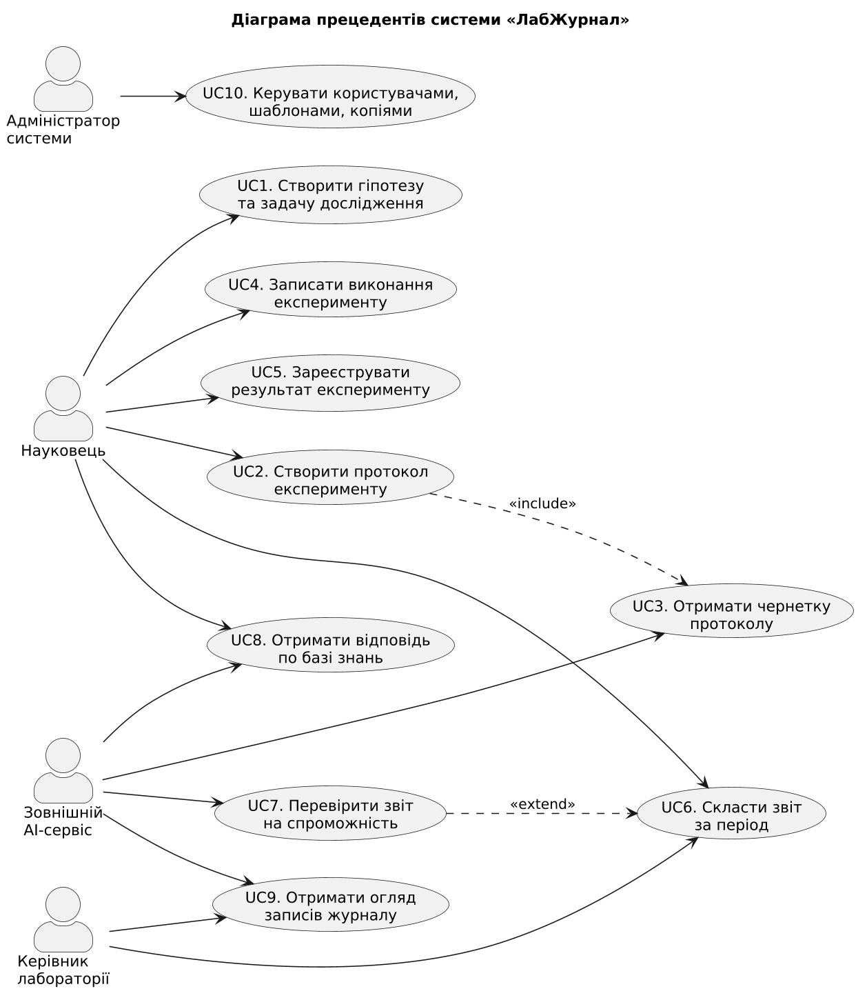
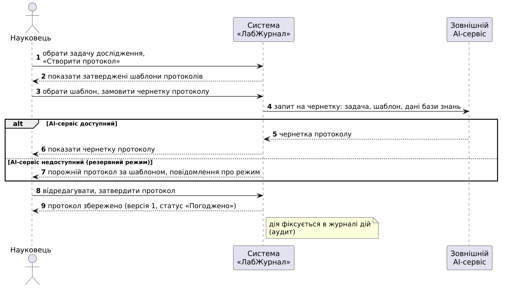
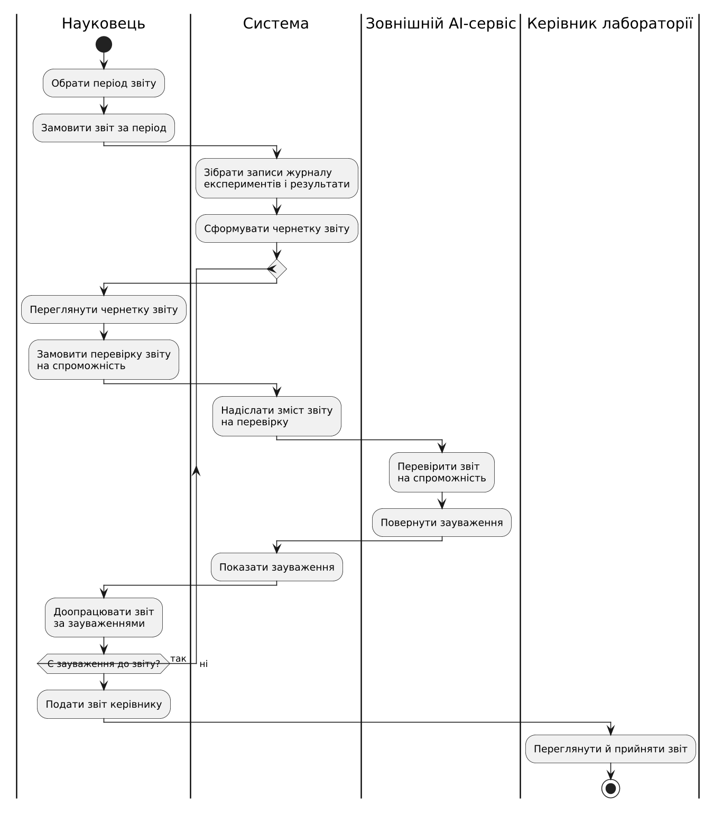

# Лабораторна робота №2

## Мета роботи

Навчитися моделювати вимоги до ІТ-проєкту: визначити акторів і прецеденти
(use case), описати їх UML-діаграмами, сформулювати історії користувача
(User Story) за критеріями INVEST із критеріями приймання у форматі
Given–When–Then та скласти фрагмент матриці трасованості (RTM).

## Завдання

Використовуючи паспорт проєкту «ЛабЖурнал» (лабораторна робота №1), розробити
Use Case та User Story для проєкту, супроводжуючи розробку відповідними
UML-діаграмами: діаграмою прецедентів (use case), діаграмою послідовностей
(sequence) і діаграмою діяльності (activity). Критерії приймання кожної
історії — у форматі Given–When–Then (BDD). Завершити роботу фрагментом
матриці трасованості RTM.

## Хід роботи

### 1. Аналіз паспорта проєкту та вимоги до системи

Вимоги до системи «ЛабЖурнал» витягнуто (elicit) з паспорта проєкту:
болі замовника (паспорт, «Предметна область і продукт»), функціональний обсяг
(пункт 7, функції F1–F8) та ролі користувачів (пункт 11). За класифікацією
теорії роботи з вимогами виділено бізнес-вимоги (цілі C1–C5 паспорта),
C-вимоги (мова потреб замовника) і D-вимоги (функціональні вимоги системи,
виражені через прецеденти та історії користувача). Нефункціональні вимоги
(якості системи з пункту 3 паспорта: швидкий пошук, цілісність даних, щоденне
резервне копіювання) розглядаються як якісні атрибути й не є предметом цієї
роботи.

C-вимоги — переклад болів замовника мовою потреб лабораторії:

| Код | C-вимога | Походження |
|---|---|---|
| C-001 | Гіпотези й задачі дослідження ведуться в одному реєстрі | «задачі ведуть у розрізнених текстах» |
| C-002 | Дослід можна повторити з записів системи | «дослід неможливо повторити з записів» |
| C-003 | Протоколи складаються за шаблонами, а не з нуля | «протоколи чернеткуються з нуля щоразу» |
| C-004 | Результати всіх експериментів зібрані в одному місці | «результати розпорошені по таблицях, файлах і пошті» |
| C-005 | Звіти складаються швидко, помилки виявляються до подання | «звіти з копіпасту, помилки знаходять пізно» |
| C-006 | Знання лабораторії доступні кожному науковцю | «досвід у головах» |
| C-007 | Доступом і даними керує адміністратор системи | нефункціональна вимога безпеки (паспорт, пункт 9) |
| C-008 | Керівник бачить узгоджену картину роботи лабораторії | «узгодженої картини нема» |

### 2. Актори системи

| Актор | Тип | Опис | Прецеденти |
|---|---|---|---|
| Науковець | людина | веде гіпотези, задачі, протоколи, експерименти й результати; працює з допоміжними модулями | UC1–UC8 |
| Керівник лабораторії | людина | замовник: переглядає звіти та огляди стану роботи | UC6, UC9 |
| Адміністратор системи | людина | керує користувачами, ролями, шаблонами, резервними копіями | UC10 |
| Зовнішній AI-сервіс | зовнішня система | зовнішній сервіс, що генерує пропозиції допоміжних модулів (чернетки, огляди, перевірки, відповіді) | UC3, UC7, UC8, UC9 |

### 3. Прецеденти (use case)

Прецеденти виведено з функцій F1–F8 паспорта. Загальний перелік:

| Код | Назва прецеденту | Актори | Функція | User Story |
|---|---|---|---|---|
| UC1 | Створити гіпотезу та задачу дослідження | Науковець | F1 | US1 |
| UC2 | Створити протокол експерименту | Науковець | F2 | US2 |
| UC3 | Отримати чернетку протоколу | Науковець, Зовнішній AI-сервіс | F2, F7 | US3 |
| UC4 | Записати виконання експерименту | Науковець | F3 | US4 |
| UC5 | Зареєструвати результат експерименту | Науковець | F4 | US5 |
| UC6 | Скласти звіт за період | Науковець, Керівник лабораторії | F5 | US6 |
| UC7 | Перевірити звіт на спроможність | Науковець, Зовнішній AI-сервіс | F5, F7 | US7 |
| UC8 | Отримати відповідь по базі знань | Науковець, Зовнішній AI-сервіс | F6, F7 | US8 |
| UC9 | Отримати огляд записів журналу | Керівник лабораторії, Зовнішній AI-сервіс | F7 | US9 |
| UC10 | Керувати користувачами, шаблонами, резервними копіями | Адміністратор системи | F8 | US10 |

Діаграма прецедентів (усі прецеденти належать системі «ЛабЖурнал»; взаємозв'язки —
UC2 включає UC3, UC7 розширює UC6):

[Джерело діаграми прецедентів](assets/usecase.puml#L1-)

Нормальний перебіг подій для кожного прецеденту.

**UC1. Створити гіпотезу та задачу дослідження.** Передумови: науковець
увійшов у систему.
1. Науковець відкриває реєстр гіпотез і обирає «Створити гіпотезу».
2. Система показує форму.
3. Науковець вводить формулювання гіпотези, задачі дослідження, строк і
   відповідального.
4. Система зберігає запис зі статусом «Нова» і показує його в реєстрі.
Результат: гіпотеза і задача зафіксовані в реєстрі.

**UC2. Створити протокол експерименту** (включає UC3). Передумови: є задача
дослідження; адміністратор затвердив шаблони протоколів.
1. Науковець обирає задачу дослідження і дію «Створити протокол».
2. Система показує затверджені шаблони протоколів.
3. Науковець обирає шаблон і замовляє чернетку протоколу (UC3).
4. Система показує чернетку протоколу.
5. Науковець редагує і затверджує протокол.
6. Система зберігає протокол (версія 1, статус «Погоджено»); дія фіксується
   в журналі дій.
Результат: протокол готовий до використання в експерименті.

**UC3. Отримати чернетку протоколу.** Передумови: науковець замовив чернетку
в межах UC2.
1. Система збирає дані задачі, вибраний шаблон і відповідні записи бази знань.
2. Система надсилає запит зовнішньому AI-сервісу.
3. Зовнішній AI-сервіс повертає чернетку протоколу.
4. Система показує чернетку науковцю з позначкою «чернетка від допоміжного
   модуля».
Альтернатива: зовнішній сервіс недоступний — система працює в резервному
режимі (порожній протокол за шаблоном і повідомлення).
Результат: чернетка на розгляді науковця; без затвердження нічого не
зберігається.

**UC4. Записати виконання експерименту.** Передумови: протокол погоджено.
1. Науковець обирає протокол і дію «Записати виконання».
2. Система показує форму журналу: дата, виконавець, умови, кроки, відхилення.
3. Науковець заповнює форму.
4. Система зберігає запис журналу, прив'язуючи його до протоколу, задачі й
   гіпотези.
Результат: експеримент зафіксовано в журналі.

**UC5. Зареєструвати результат експерименту.** Передумови: є запис журналу про
виконання експерименту.
1. Науковець обирає запис журналу і дію «Додати результат».
2. Система показує форму результату (таблиця значень) і завантаження файлів.
3. Науковець вводить значення і прикріплює файли.
4. Система зберігає результат і прив'язує його до експерименту.
Результат: результат зареєстровано в реєстрі результатів.

**UC6. Скласти звіт за період** (розширюється UC7). Передумови: за період є
записи журналу та результати.
1. Науковець обирає період і дію «Скласти звіт».
2. Система збирає записи журналу й результати за період.
3. Система формує чернетку звіту.
4. Науковець переглядає чернетку, за потреби замовляє перевірку на спроможність
   (UC7) і доопрацьовує звіт.
5. Науковець подає звіт керівнику лабораторії.
6. Керівник лабораторії переглядає і приймає звіт.
Результат: звіт за період складено й прийнято.

**UC7. Перевірити звіт на спроможність.** Передумови: є чернетка звіту.
1. Науковець замовляє перевірку звіту на спроможність.
2. Система надсилає зміст звіту зовнішньому AI-сервісу.
3. Зовнішній AI-сервіс повертає зауваження (пропуски, неузгодженості).
4. Система показує зауваження з посиланнями на записи.
Альтернатива: сервіс недоступний — звіт можна подати без перевірки, з
відповідною позначкою.
Результат: науковець має перелік зауважень до звіту.

**UC8. Отримати відповідь по базі знань.** Передумови: науковець увійшов у
систему.
1. Науковець ставить питання в пошуку по базі знань.
2. Система надсилає питання і вміст бази знань зовнішньому AI-сервісу.
3. Зовнішній AI-сервіс повертає відповідь із посиланнями на статті бази знань.
4. Система показує відповідь із посиланнями.
Результат: науковець отримав відповідь із джерелами.

**UC9. Отримати огляд записів журналу.** Передумови: керівник лабораторії
увійшов у систему.
1. Керівник обирає період і дію «Огляд записів журналу».
2. Система збирає записи за період і замовляє підсумок у допоміжного модуля.
3. Система показує огляд: скільки експериментів виконано, які задачі в роботі,
   що зупинилося.
Альтернатива: допоміжний модуль недоступний — огляд показується як перелік
записів без підсумків.
Результат: керівник бачить стан роботи лабораторії за період.

**UC10. Керувати користувачами, шаблонами, резервними копіями.** Передумови:
адміністратор увійшов у систему.
1. Адміністратор додає або змінює користувача, призначає роль.
2. Адміністратор затверджує шаблони протоколів і звітів.
3. Адміністратор переглядає стан резервного копіювання і запускає копіювання.
4. Система фіксує всі дії в журналі дій.
Результат: користувачі, шаблони й копії під контролем адміністратора.

#### Діаграма послідовностей (UC2)

Діаграма послідовностей описує основний шлях користувача в прецеденті UC2:
обмін повідомленнями між науковцем, системою і зовнішнім AI-сервісом, зокрема
альтернативу резервного режиму, коли зовнішній сервіс недоступний (ризик R3
паспорта).

[Джерело діаграми послідовностей](assets/sequence.puml#L1-)

#### Діаграма діяльності (UC6)

Діаграма діяльності описує перебіг прецеденту UC6 за ролями (смуги
відповідальності): складання звіту, перевірка на спроможність допоміжним
модулем, цикл доопрацювання за зауваженнями та приймання звіту керівником
лабораторії.

[Джерело діаграми діяльності](assets/activity.puml#L1-)

### 4. Історії користувача (User Story)

Історії формулювалися за патерном теорії «Як <роль>, я хочу <мета>, щоб
<цінність>», без технічного жаргону, і перевірялися за мнемонікою INVEST:
Independent (незалежна), Negotiable (обговорювана), Valuable (цінна),
Estimable (оцінювана), Small (компактна), Testable (тестована). Для кожної
історії наведено оцінку складності (сторі-пойнти, шкала 1–8) і орієнтовний
час реалізації, а також 2–4 критерії приймання у форматі Given–When–Then
(успіх / відмова / виняток).

**US1. Реєстр гіпотез і задач дослідження.** Як науковець, я хочу фіксувати
гіпотези та задачі дослідження в одному реєстрі, щоб задачі не губилися між
документами. Пріоритет: Must. Складність: 3 бали, орієнтовно 3 дні.

- *Успіх.* **Given** науковець увійшов у систему **When** він створює гіпотезу
  «...» і задачу дослідження **Then** запис збережено зі статусом «Нова», з
  зазначенням автора й дати.
- *Відмова.* **Given** не заповнено обов'язкове поле «формулювання гіпотези»
  **When** науковець натискає «Зберегти» **Then** система показує повідомлення
  про помилку, запис не створюється.
- *Виняток.* **Given** задача з таким формулюванням уже є в реєстрі **When**
  науковець зберігає дублікат **Then** система попереджає про дублікат і
  пропонує відкрити наявний запис.

**US2. Протокол за шаблоном.** Як науковець, я хочу створювати протокол
експерименту за затвердженим шаблоном, щоб не чернеткувати його з нуля
щоразу. Пріоритет: Must. Складність: 5 балів, орієнтовно 5 днів.

- *Успіх.* **Given** є задача дослідження і затверджені шаблони **When**
  науковець створює протокол за шаблоном **Then** протокол містить усі розділи
  шаблону, статус «Чернетка».
- *Відмова.* **Given** для задачі немає жодного затвердженого шаблону **When**
  науковець створює протокол **Then** система пропонує звернутися до
  адміністратора, протокол не створюється.
- *Виняток.* **Given** шаблон змінено адміністратором під час роботи над
  протоколом **When** науковець відкриває протокол **Then** система показує
  повідомлення і пропонує оновити протокол до нової версії шаблону.

**US3. Чернетка протоколу від допоміжного модуля.** Як науковець, я хочу
отримувати чернетку протоколу від допоміжного модуля, щоб швидше
готуватися до експерименту. Пріоритет: Should. Складність: 5 балів,
орієнтовно 5 днів.

- *Успіх.* **Given** задача містить опис методики **When** науковець замовляє
  чернетку протоколу **Then** не пізніше ніж за 60 секунд система показує
  чернетку з кроками з методики, з позначкою «чернетка від допоміжного
  модуля».
- *Відмова.* **Given** чернетка не містить розділу «Умови» **When** науковець
  переглядає чернетку **Then** він відхиляє її; система не вносить чернетку до
  протоколу і фіксує відхилення.
- *Виняток.* **Given** зовнішній AI-сервіс недоступний **When** науковець
  замовляє чернетку **Then** система працює в резервному режимі: порожній
  протокол за шаблоном і повідомлення про режим.

**US4. Запис виконання експерименту в журналі.** Як науковець, я хочу
записувати виконання експерименту (дата, умови, кроки, відхилення) в журналі,
щоб дослід можна було повторити за записами. Пріоритет: Must. Складність:
3 бали, орієнтовно 3 дні.

- *Успіх.* **Given** протокол погоджено **When** науковець записує виконання
  експерименту **Then** запис журналу збережено і прив'язано до протоколу,
  задачі та гіпотези.
- *Відмова.* **Given** не зазначено дату виконання **When** науковець
  зберігає запис **Then** система не зберігає запис і показує повідомлення про
  помилку.
- *Виняток.* **Given** експеримент виконано з відхиленням від протоколу
  **When** науковець зберігає запис **Then** система вимагає описати відхилення
  і позначає запис «З відхиленнями».

**US5. Реєстр результатів.** Як науковець, я хочу реєструвати результати
експериментів і прикріплювати файли, щоб усі дані були в одному місці.
Пріоритет: Must. Складність: 3 бали, орієнтовно 3 дні.

- *Успіх.* **Given** є запис журналу про експеримент **When** науковець додає
  таблицю значень і файл **Then** результат збережено і прив'язано до
  експерименту.
- *Відмова.* **Given** файл перевищує встановлений ліміт розміру **When**
  науковець завантажує файл **Then** система відхиляє файл із повідомленням.
- *Виняток.* **Given** два науковці змінюють один результат одночасно **When**
  другий зберігає зміни **Then** система попереджає про конфлікт і показує
  останню збережену версію.

**US6. Звіт за період.** Як науковець, я хочу складати звіт за період із
записів журналу та результатів, щоб не збирати його копіпастом. Пріоритет:
Must. Складність: 5 балів, орієнтовно 5 днів.

- *Успіх.* **Given** за період є записи журналу та результати **When**
  науковець замовляє звіт за цей період **Then** система формує чернетку звіту
  з переліком експериментів і результатів.
- *Відмова.* **Given** за період немає записів **When** науковець замовляє
  звіт **Then** система повідомляє про це і не формує порожній звіт.
- *Виняток.* **Given** частина результатів не прив'язана до експериментів
  **When** система формує звіт **Then** такі дані винесено окремим розділом
  «Незавершені дані».

**US7. Перевірка звіту на спроможність.** Як науковець, я хочу перевіряти
звіт на спроможність допоміжним модулем перед поданням, щоб знаходити помилки
раніше. Пріоритет: Should. Складність: 3 бали, орієнтовно 3 дні.

- *Успіх.* **Given** чернетка звіту готова **When** науковець замовляє
  перевірку на спроможність **Then** не пізніше ніж за 2 хвилини система
  показує перелік зауважень із посиланнями на записи.
- *Відмова.* **Given** перевірка не знайшла зауважень **When** науковець
  замовляє перевірку **Then** система показує «Зауважень немає», звіт можна
  подавати.
- *Виняток.* **Given** перевірку перервано через недоступність зовнішнього
  сервісу **When** науковець замовляє перевірку **Then** система повідомляє
  про режим; звіт можна подати без перевірки, з відповідною позначкою.

**US8. Відповіді по базі знань.** Як науковець, я хочу ставити питання по базі
знань і отримувати відповіді з посиланнями на записи, щоб швидко знаходити
досвід лабораторії. Пріоритет: Should. Складність: 8 балів, орієнтовно
8 днів.

- *Успіх.* **Given** в базі знань є стаття про підготовку розчину **When**
  науковець ставить питання «як підготувати розчин» **Then** не пізніше ніж за
  30 секунд система показує відповідь із посиланнями на статті.
- *Відмова.* **Given** у базі знань немає відповіді на питання **When**
  науковець ставить питання **Then** система пропонує переформулювати питання
  або створити нову статтю.
- *Виняток.* **Given** відповідь посилається на статтю, яку видалено **When**
  система показує відповідь **Then** вона попереджає, що джерело застаріло, і
  пропонує актуальні статті.

**US9. Огляд записів журналу.** Як керівник лабораторії, я хочу отримувати
огляд записів журналу за період, щоб бачити стан роботи лабораторії без
читання всіх записів. Пріоритет: Could. Складність: 3 бали, орієнтовно 3 дні.

- *Успіх.* **Given** за період є записи журналу **When** керівник замовляє
  огляд за період **Then** система показує підсумок: скільки експериментів
  виконано, які задачі в роботі, що зупинилося.
- *Відмова.* **Given** за період немає активності **When** керівник замовляє
  огляд **Then** огляд містить повідомлення «Записів за період немає».
- *Виняток.* **Given** допоміжний модуль недоступний **When** керівник
  замовляє огляд **Then** система показує огляд як перелік записів без
  підсумків.

**US10. Адміністрування системи.** Як адміністратор системи, я хочу керувати
користувачами, ролями та резервними копіями, щоб доступ і дані були під
контролем. Пріоритет: Must. Складність: 5 балів, орієнтовно 5 днів.

- *Успіх.* **Given** адміністратор додає нового науковця з роллю «Науковець»
  **When** він зберігає користувача **Then** користувач отримує доступ, дія
  записана в журналі дій.
- *Відмова.* **Given** користувач із таким логіном уже існує **When**
  адміністратор зберігає **Then** система відхиляє створення з повідомленням.
- *Виняток.* **Given** щоденне резервне копіювання не вдалося **When** система
  виконує розклад **Then** адміністратор отримує повідомлення, спробу
  повторюються, подія фіксується в журналі дій.

Перевірка історій за INVEST:

| Історія | I | N | V | E | S | T | Примітка |
|---|---|---|---|---|---|---|---|
| US1 | + | + | + | + | + | + | |
| US2 | + | + | + | + | + | + | |
| US3 | + | + | + | + | + | + | не залежить від US2: чернетка працює і в порожньому протоколі |
| US4 | + | + | + | + | + | + | |
| US5 | + | + | + | + | + | + | |
| US6 | + | + | + | + | + | + | |
| US7 | + | + | + | + | + | + | |
| US8 | + | + | + | + | + | + | найбільша історія — 8 балів; під час планування ітерацій буде поділена на дві |
| US9 | + | + | + | + | + | + | |
| US10 | + | + | + | + | + | + | |

### 5. Матриця трасованості (RTM)

Матриця трасованості (RTM) зв'язує C-вимоги, D-вимоги (історії користувача),
прецеденти й тести та дає змогу аналізувати вплив змін і контролювати
охоплення. Наводжу фрагмент RTM у колонках шаблону (фрагмент — перші десять
рядків, що відповідають історіям US1–US10):

| Req ID (C/D) | Назва | Тип | Джерело | Пов'язано з (Use Case) | Test ID | Пріоритет (MoSCoW) | Статус |
|---|---|---|---|---|---|---|---|
| C-001 / D-001 | Реєстр гіпотез і задач | C→D/FR | Замовник / паспорт F1 | UC1 | TC-101 | Must | Planned |
| C-003 / D-002 | Протокол за шаблоном | C→D/FR | Замовник / паспорт F2 | UC2 | TC-102 | Must | Planned |
| C-003 / D-003 | Чернетка протоколу | C→D/FR | Паспорт F2, F7 | UC2 → UC3 | TC-103 | Should | Planned |
| C-002 / D-004 | Запис експерименту в журнал | C→D/FR | Замовник / паспорт F3 | UC4 | TC-104 | Must | Planned |
| C-004 / D-005 | Реєстр результатів | C→D/FR | Замовник / паспорт F4 | UC5 | TC-105 | Must | Planned |
| C-005 / D-006 | Звіт за період | C→D/FR | Замовник / паспорт F5 | UC6 | TC-106 | Must | Planned |
| C-005 / D-007 | Перевірка звіту на спроможність | C→D/FR | Паспорт F5, F7 | UC6 → UC7 | TC-107 | Should | Planned |
| C-006 / D-008 | Відповіді по базі знань | C→D/FR | Замовник / паспорт F6, F7 | UC8 | TC-108 | Should | Planned |
| C-008 / D-009 | Огляд записів журналу | C→D/FR | Замовник / паспорт F7 | UC9 | TC-109 | Could | Planned |
| C-007 / D-010 | Адміністрування | C→D/FR | Паспорт F8 | UC10 | TC-110 | Must | Planned |

Статус усіх рядків — Planned: вимоги описано, реалізація запланована на етапи
3–4 графіка паспорта. Тести TC-101…TC-110 відповідають критеріям приймання
історій US1–US10 (сценарії Given–When–Then, розділ 4).

### 6. Валідація та верифікація вимог

Розробку вимог супроводжено перевіркою якості за чек-листом теорії:

- **Чітко?** Усі історії написані мовою потреб лабораторії, без технічного
  жаргону; терміни «гіпотеза», «протокол», «експеримент», «результат»,
  «звіт», «база знань» узяті з паспорта проєкту.
- **Перевірно?** До кожної історії складено критерії приймання
  Given–When–Then (успіх, відмова, виняток) — 30 сценаріїв.
- **Узгоджено?** Історії не суперечать одна одній і покривають усі функції
  F1–F8 паспорта (таблиця «Прецеденти»).
- **Трасовано?** Зв'язок C-вимоги ↔ D-вимоги ↔ прецеденти ↔ тести наведено в
  RTM (розділ 5).
- **Реалістично?** Оцінки складності й часу вкладаються в етапи 3–4 графіка
  паспорта; залежність від зовнішнього AI-сервісу обмежена резервним режимом
  (ризик R3 паспорта).

Валідацію («чи це те, що нам потрібно?») забезпечено походженням кожної
C-вимоги з конкретного болю замовника; верифікацію («чи правильно описано?») —
перевіркою за INVEST і чек-листом якості вище.

## Результати

Визначено 4 акторів і 10 прецедентів системи «ЛабЖурнал»; побудовано та
відрендерено три UML-діаграми: діаграму прецедентів, діаграму послідовностей
(UC2) і діаграму діяльності (UC6). Для кожного прецеденту описано нормальний
перебіг подій. Сформулювано 10 історій користувача за INVEST із 30
критеріями приймання Given–When–Then. Складено фрагмент матриці трасованості
RTM: 8 C-вимог → 10 D-вимог (US1–US10) → 10 тестів (TC-101–TC-110).
Ланцюжок паспорт → вимоги → історії узгоджений: кожна функція F1–F8 паспорта
має прецедент і історію користувача.

## Висновки

Вимоги до системи «ЛабЖурнал» змодельовано повністю: від болів замовника
(C-вимоги) до функціональних вимог у вигляді прецедентів і історій користувача
з критеріями приймання. UML-діаграми описують структуру прецедентів, обмін
повідомленнями створення протоколу та перебіг складання звіту. Матриця
трасованості забезпечує простежуваність вимог до тестів і готова до ведення
під час реалізації; пріоритети MoSCoW історій будуть використані для
планування робіт проєкту.

## Використання штучного інтелекту

Використано модель `deepseek-v4.1-flash-1017` у середовищі `opencode`;
результати отримано запуском коду, зміст перевірено автором.
