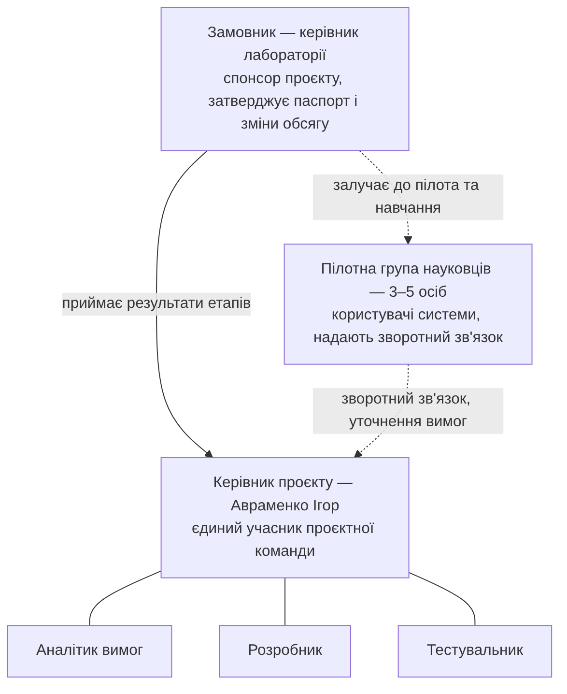
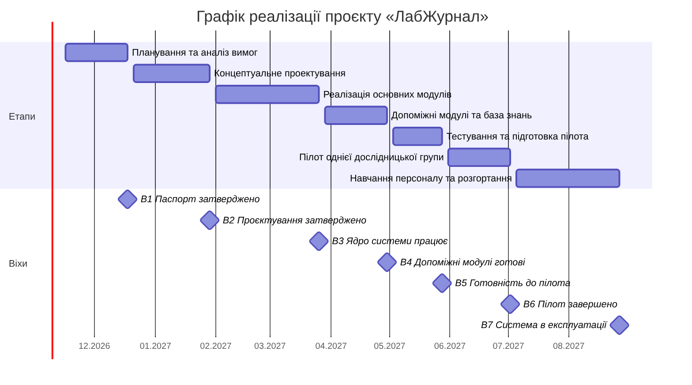

# Лабораторна робота №1

## Мета роботи

Опрацювати етап ініціації ІТ-проєкту: скласти паспорт проєкту впровадження
інформаційної системи в науковій лабораторії — від цілей і обсягу до ризиків,
індикаторів якості та графіка реалізації.

## Завдання

За роздаткою «Паспорт проект» розробити паспорт проєкту з 21 пункту.
Предметна область — «Лабораторія» (пункт 44 «Інша ПО» з Переліку предметних
областей). Приклад заповнення — «IC Project Charter with Example Data B».
Окремо побудувати діаграму організаційної структури проєкту та графік
реалізації.

## Хід роботи

### 1. Предметна область і продукт проєкту

**Замовник** — керівник наукової дослідницької лабораторії. Цикл роботи
лабораторії класичний і ручний: гіпотези фіксуються в документах, задачі
дослідження ведуть у розрізнених текстах, експерименти виконуються за
протоколами, результати — у таблицях і файлах, звіти складаються вручну.
Типові болі замовника такі, як їх описує сам керівник лабораторії:

- дослід неможливо повторити з записів — кроки, умови й джерела губляться;
- протоколи чернеткуються з нуля щоразу;
- результати розпорошені по таблицях, файлах і пошті — узгодженої картини нема;
- звіти складаються з копіпасту, помилки знаходять пізно;
- досвід «в головах», передача новим науковцям повільна.

**Продукт проєкту** — внутрішня веб-система лабораторії **«ЛабЖурнал»**:
журнал наукової роботи в дусі спрощеної лабораторної інформаційної системи —
реєстр гіпотез і задач дослідження, протоколи й журнал експериментів, реєстр
результатів, внутрішня база знань.

До складу системи входять допоміжні модулі: вони пропонують науковцям чернетки
протоколів за шаблоном, огляди записів журналу, перевірку звітів на спроможність,
пошук і відповіді по базі знань. Це внесок виконавця проєкту: замовник не має
такого досвіду, модулі працюють на основі зовнішніх AI-моделей через API, а їхнє
впровадження (пілот, навчання науковців) — частина проєктного рішення.

### 2. Паспорт проєкту «ЛабЖурнал»

**1. Цілі проекту.** Головна мета — за 9,5 місяців розробити й впровадити в
лабораторії систему «ЛабЖурнал», що збирає весь цикл наукової роботи в одному
місці. Конкретні цілі:

- **C1.** Забезпечити повторюваність дослідів: кожен експеримент має повний
  запис кроків, умов і джерел.
- **C2.** Скоротити час підготовки протоколів і звітів щонайменше вдвічі.
- **C3.** Зібрати знання лабораторії в базі знань, доступній усім науковцям.
- **C4.** Знизити кількість помилок у звітах завдяки перевіркам і допоміжним
  модулям.
- **C5.** Навчити науковців працювати в системі, зокрема з допоміжними модулями.

Індикатори досягнення цих цілей — у пункті 18.

**2. Орієнтована тривалість проекту та можливі етапи.** Тривалість — 9,5
місяців: 16.11.2026 — 27.08.2027. Проєкт поділено на сім етапів; кожен етап
завершується віхою — перевіреним результатом, який приймає замовник.

| № | Етап | Початок | Кінець | Віха |
|---|---|---|---|---|
| 1 | Планування та аналіз вимог | 16.11.2026 | 18.12.2026 | В1 |
| 2 | Концептуальне проектування | 21.12.2026 | 29.01.2027 | В2 |
| 3 | Реалізація основних модулів | 01.02.2027 | 26.03.2027 | В3 |
| 4 | Допоміжні модулі та база знань | 29.03.2027 | 30.04.2027 | В4 |
| 5 | Тестування та підготовка пілота | 03.05.2027 | 28.05.2027 | В5 |
| 6 | Пілот однієї дослідницької групи | 31.05.2027 | 02.07.2027 | В6 |
| 7 | Навчання персоналу та розгортання | 05.07.2027 | 27.08.2027 | В7 |

**3. Опис продукту проекту: якості, можливості, переваги.** «ЛабЖурнал» —
внутрішня веб-система, до якої науковці заходять з браузера. Можливості
(функціональний перелік — у пункті 7): облік гіпотез і задач, протоколи
експериментів, журнал виконаних експериментів, реєстр результатів, звіти,
база знань, допоміжні модулі. Якості: зрозумілий інтерфейс без спеціального
навчання; робота з браузера звичайного комп'ютера; швидкий пошук за всіма
записами; цілісність даних і щоденне резервне копіювання. Переваги: єдина
узгоджена картина роботи лабораторії; протоколи складаються з шаблонів, а не
з нуля; дослід можна повторити за записами; знання не зникають разом із
науковцем; допоміжні модулі беруть на себе рутину чернеток і оглядів, а
рішення завжди лишається за науковцем.

**4. Стратегія впровадження.** «Пілот однієї групи + навчання персоналу»:

1. Пілот: одна дослідницька група (3–5 науковців) веде в системі один напрям
   роботи — гіпотези, протоколи, експерименти, результати.
2. Оцінка пілота за індикаторами пункту 18, уточнення системи за зворотним
   зв'язком групи.
3. Навчання персоналу: семінари, інструкція користувача, онбордінг-сторінка.
4. Перенесення решти напрямів роботи лабораторії та введення системи в
   штатну експлуатацію.

Впровадження поетапне, не «великий вибух»: допоміжні модулі вмикаються після
того, як науковці освоїли основні функції.

**5. Обсяг проекту.** У межах проєкту: розробка системи «ЛабЖурнал»;
налаштування сервера лабораторії; перенесення чинних записів (протоколи,
результати за останній рік); стартове наповнення бази знань; пілот однієї
групи; навчання персоналу; супроводження перші 6 місяців експлуатації. Поза
межами проєкту: закупівля обладнання; зміна інших систем лабораторії; проведення
самих дослідів; обробка даних поза системою; супроводження після 6 місяців
експлуатації.

**6. Необхідні ресурси проекту.** Людські ресурси: виконавець — Авраменко Ігор
(керівник проєкту, аналітик вимог, розробник і тестувальник в одній особі); з боку
лабораторії — керівник (замовник, 1–2 год на тиждень на погодження) та пілотна
група з 3–5 науковців (2–3 год на тиждень на уточнення вимог і пілот).
Матеріально-технічні: сервер лабораторії або університетський (звичайний
комп'ютер від 8 ГБ оперативної пам'яті), робочі місця науковців із сучасним
браузером. Програмне забезпечення: безкоштовне відкрите ПЗ (операційна система,
СКБД, веб-сервер). Зовнішні послуги: API-ключі AI-сервісів для допоміжних
модулів (оплата за фактичним використанням). Фінанси: кошторис — до 5 000 грн
на оплату зовнішніх сервісів протягом проєкту; робота виконавця виконується
власними силами без оплати.

**7. Функціональний обсяг.** Функції системи «ЛабЖурнал»:

| Код | Функція | Опис |
|---|---|---|
| F1 | Облік гіпотез і задач дослідження | реєстр гіпотез, задач, статусів, відповідальних |
| F2 | Протоколи експериментів | шаблони, чернетки протоколів, версії, погодження |
| F3 | Журнал експериментів | запис про виконання: дата, виконавець, умови, кроки |
| F4 | Реєстр результатів | таблиці й файли результатів, прив'язка до експерименту |
| F5 | Звіти | збірка звіту за період із записів і результатів |
| F6 | База знань | описи методик, шаблони, типові питання, пошук |
| F7 | Допоміжні модулі | чернетки протоколів, огляди журналу, перевірка звітів на спроможність, відповіді по базі знань |
| F8 | Адміністрування | користувачі, ролі, шаблони, журнал дій у системі |

**8. Географічний обсяг проекту.** Проєкт охоплює одну лабораторію —
приміщення в одному корпусі університету. Система розміщується на сервері
лабораторії; доступ — через браузер із локальної мережі університету та
віддалено через VPN, тому учасники пілота можуть працювати і з дому.
Географічно розподілених майданчиків немає; резервні копії зберігаються на
окремому диску в тому самому приміщенні та раз на місяць виносяться за межі
корпусу.

**9. Технічний обсяг.** Веб-додаток: серверна частина, база даних, файлове
сховище вкладень, клієнт — сучасний браузер. Модуль інтеграції зі зовнішніми
AI-сервісами через API (HTTP) обслуговує допоміжні модулі (F7). Резервне
копіювання — щоденне. Обмеження: комп'ютер із сучасним браузером і доступом до
інтернету; смартфони — лише для перегляду. Не входить до технічного обсягу:
мобільний застосунок, інтеграція з лабораторними приладами, імпорт з
приладових форматів.

**10. Важливі припущення (обмеження).** Припущення: науковці мають базові
навички роботи з браузером і таблицями; сервер і мережа університету доступні
протягом проєкту; керівник лабораторії забезпечує участь пілотної групи;
чинні записи за останній рік можна перенести у вигляді файлів і таблиць;
зовнішні AI-сервіси доступні через інтернет і мають публічні умови
використання. Обмеження: один виконавець із навантаженням не більше 20 годин
на тиждень; мінімальний бюджет; граничний термін завершення — 27.08.2027;
проєкт не змінює чинні процеси лабораторії поза межами пункту 5.

**11. Організаційна структура проекту і функціональні ролі.** Проєктна
команда — одна особа, Авраменко Ігор, який виконує ролі керівника проєкту,
аналітика вимог, розробника і тестувальника. Замовник — керівник лабораторії:
затверджує паспорт, приймає результати етапів, ухвалює рішення про зміни
обсягу. Пілотна група науковців залучається як користувачі: уточнює вимоги,
бере участь у пілоті, надає зворотний зв'язок.

| Роль | Хто виконує | Функції |
|---|---|---|
| Замовник | керівник лабораторії | затвердження паспорта і змін, приймання етапів |
| Керівник проєкту | Авраменко Ігор | планування, звітність, управління змінами |
| Аналітик вимог | Авраменко Ігор | інтерв'ю, реєстр вимог, прототипи |
| Розробник | Авраменко Ігор | розробка, розгортання, усунення помилок |
| Тестувальник | Авраменко Ігор | тест-кейси, приймальні перевірки |
| Користувачі | пілотна група, 3–5 науковців | робота в системі, зворотний зв'язок |

**12. Огляд методології.** Обрано ітеративний підхід з етапними віхами:
робота виконується ітераціями по 2–3 тижні, кожна завершується демонстрацією
результату замовнику; етапи проєкту — згідно з календарним планом (пункт 21).
Класична каскадна модель не підходить: вимоги уточнюються під час пілота, а
замовник залучений регулярно. З методології управління проєктом
використовуються: календарний план і діаграма Ганту, структурна декомпозиція
робіт за етапами, віхи як контрольні точки, реєстр вимог, реєстр змін обсягу,
звіт про виконання етапу. Пріоритети вимог визначаються за шкалою MoSCoW
(Must, Should, Could, Won't) і переглядаються на етапній зустрічі.

**13. Концептуальне проектування.** Основні сутності системи та їхні зв'язки:

| Сутність | Опис | Зв'язки |
|---|---|---|
| Гіпотеза | припущення, що перевіряється дослідом | містить задачі дослідження |
| Задача дослідження | конкретне питання, що відпрацьовується | належить гіпотезі, реалізується експериментами |
| Протокол експерименту | опис кроків, умов, джерел | створюється для задачі, використовується експериментом |
| Експеримент (запис журналу) | факт виконання: дата, виконавець, умови, відхилення | використовує протокол, має результати |
| Результат | таблиця або файл зі значеннями | належить експерименту, використовується у звітах |
| Звіт | узагальнення за період | складається з експериментів і результатів |
| Стаття бази знань | методика, шаблон, типове питання | посилається на гіпотези, задачі, протоколи |
| Користувач | науковець або адміністратор | веде записи, працює з допоміжними модулями |

Архітектура — три частини: ядро обліку (F1–F5, F8), база знань (F6) і
допоміжні модулі (F7). Допоміжні модулі читають дані ядра та бази знань і
повертають науковцю пропозиції (чернетку протоколу, огляд, відповідь);
кожна пропозиція проходить перевірку науковця і вноситься до системи лише після
його затвердження. Для генерації пропозицій використовуються зовнішні
AI-сервіси через API.

**14. Реалізація та заключне тестування.** Реалізація ведеться ітераціями в
межах етапів 3–4 (див. пункт 21): кожна ітерація — це працюючий приріст
функцій, який демонструється замовнику. Тестування поділено на рівні:
функціональні сценарії за реєстром вимог; перевірка цілісності даних;
приймальне тестування за участі пілотної групи за чек-листами; заключне
тестування перед пілотом (пункт 5). Допоміжні модулі перевіряються окремо:
науковець оцінює кожну пропозицію (приймає або відхиляє), і частка прийнятих
пропозицій фіксується як показник якості модуля. Критерії готовності етапу:
виконані сценарії, немає відкритих критичних помилок, замовник прийняв
результат етапу.

**15. Експлуатація та підтримка (супроводження проекту).** Система
розгортається на сервері лабораторії, резервне копіювання — щоденне, оновлення
— за погодженням із замовником. Виконавець супроводжує систему перші 6 місяців
експлуатації: усуває помилки, консультує користувачів, уточнює допоміжні
модулі за зворотним зв'язком. Далі адміністрування переходить до лабораторії
за інструкцією адміністратора; звіти про простій і збої ведуться в журналі
адміністрування.

**16. Управління змінами обсягу проекту.** Будь-яка зміна обсягу проходить
однаковий шлях: 1) заявка на зміну фіксується в реєстрі змін (хто, що, навіщо);
2) керівник проєкту оцінює вплив на терміни, якість і ресурси; 3) замовник
ухвалює рішення — включити в поточний етап, відкласти чи відхилити; 4) зміни
вносяться до паспорта й календарного плану, учасники отримують повідомлення.
Рішення приймаються на етапній зустрічі; зміна, що зсуває віху більш ніж на
два тижні, потребує окремого рішення замовника про перенесення терміну.
Пріоритети нових вимог визначаються за MoSCoW.

**17. Можливі ризики.** Ідентифіковані ризики проєкту (подальший аналіз і план
реагування — в управлінні ризиками):

| Код | Ризик | Можливі наслідки | Напрям реагування |
|---|---|---|---|
| R1 | Низька залученість науковців, опір новому | пілот без користувачів, хибні вимоги | пілот однієї групи, навчання, простий інтерфейс |
| R2 | Дані розпорошені, складна міграція | перенесення затягується | перенесення за напрямами, спочатку нові записи |
| R3 | Нестабільність зовнішніх AI-сервісів (збої, зміна умов) | допоміжні модулі недоступні | резервний режим роботи без допоміжних модулів |
| R4 | Помилкові пропозиції допоміжних модулів | хибні дані в протоколах і звітах | обов'язкова перевірка науковцем, журнал пропозицій |
| R5 | Зрив термінів через навантаження виконавця | зсув віх | резерв часу в графіку, пріоритети MoSCoW |
| R6 | Недостатньо матеріалів для бази знань | база знань порожня | наповнення під час пілота, збір записів у науковців |
| R7 | Складнощі з розгортанням на сервері університету | затримка пілота | тестове середовище, домовленість з адміністратором заздалегідь |
| R8 | Зміна вимог після пілота | перевантаження обсягу | управління змінами обсягу (пункт 16) |

**18. Забезпечення якості, індикатори досягнення мети.** Забезпечення якості:
критерії готовності кожного етапу (пункт 14); приймальне тестування за
участі пілотної групи; перевірка пропозицій допоміжних модулів людиною;
інспекція документів (протоколи, звіти) за шаблонами; зворотний зв'язок
пілотної групи після кожної ітерації. Індикатори досягнення мети (значення —
орієнтири, що уточнюються на пілоті):

| Код | Індикатор | Орієнтир |
|---|---|---|
| K1 | Частка експериментів, які можна повторити за записами системи | ≥ 80 % через 3 місяці пілота |
| K2 | Середній час складання протоколу | скорочення щонайменше вдвічі проти виміряного до пілота |
| K3 | Частка науковців пілотної групи, що веде роботу в системі щотижня | ≥ 80 % |
| K4 | Кількість помилок у звітах, знайдених після подання | зменшення втричі проти початкового рівня |
| K5 | Час підготовки звіту за період | скорочення щонайменше на 30 % |

**19. Регламентне забезпечення якості.** Якість підтримується документами:
чинне положення лабораторії про ведення протоколів і записів; правила
університету щодо зберігання дослідницьких даних; інструкція користувача
системи «ЛабЖурнал»; регламент роботи з допоміжними модулями (кожна пропозиція
перевіряється науковцем, пропозиція без перевірки не вноситься до записів);
порядок резервного копіювання та відновлення; регламент розгляду змін обсягу
(пункт 16); затверджені замовником шаблони протоколів і звітів.

**20. Передача знань (формування бази знань).** База знань (F6) — складова
системи, що зберігає досвід лабораторії. Стартове наповнення: шаблони
протоколів, описи методик, типові питання й відповіді. Під час пілота науковці
додають записи за своїми напрямами; допоміжний модуль відповідей по базі знань
скорочує пошук досвіду. Передача знань новим науковцям: онбордінг-сторінка
(розгортання, як користуватися системою, як працювати з допоміжними модулями),
два вступні семінари та короткі інструкції. Адміністрування передається
лабораторії разом з інструкцією адміністратора (пункт 15).

**21. Терміни (план дій, графік реалізації).** План дій за етапами:

| Етап | Основні дії | Результат етапу | Термін | Віха |
|---|---|---|---|---|
| 1. Планування та аналіз вимог | інтерв'ю з науковцями, реєстр вимог, паспорт | погоджений паспорт і реєстр вимог | 16.11.2026 — 18.12.2026 | В1 |
| 2. Концептуальне проектування | сутності, архітектура, прототип інтерфейсу | затверджене проєктування | 21.12.2026 — 29.01.2027 | В2 |
| 3. Реалізація основних модулів | F1–F5, F8; розгортання тестового середовища | ядро системи працює | 01.02.2027 — 26.03.2027 | В3 |
| 4. Допоміжні модулі та база знань | F6–F7, інтеграція з AI-сервісами, наповнення бази | допоміжні модулі готові | 29.03.2027 — 30.04.2027 | В4 |
| 5. Тестування та підготовка пілота | функціональні перевірки, чек-листи, навчальні матеріали | готовність до пілота | 03.05.2027 — 28.05.2027 | В5 |
| 6. Пілот однієї групи | робота групи в системі, збір зворотного зв'язку, уточнення | пілот завершено, оцінка індикаторів | 31.05.2027 — 02.07.2027 | В6 |
| 7. Навчання та розгортання | семінари, онбордінг, перенесення решти напрямів, супровід | система в експлуатації | 05.07.2027 — 27.08.2027 | В7 |

Графік реалізації (діаграма Ганту):

### Календарний план у Linear

23.11.2026 календарний план паспорта перенесено до проєкту
[«ЛабЖурнал — планування» у Linear](https://linear.app/ihor-av/project/labzhurnal-planuvannya-fdb711cf52dd).
Для проєкту встановлено планові дати 16.11.2026–27.08.2027 і створено сім
віх В1–В7 із датами завершення з таблиці вище; опис кожної віхи містить
плановий початок і кінець відповідного етапу. Запитом до Linear перевірено
збережені дати та всі сім віх. На 23.11.2026 календарний план передбачає
етап 1; сам факт настання дати не підтверджує виконання його робіт.

Початковий паспорт описує одну людину в чотирьох ролях. Пізніше до роботи
залучено трьох ШІ-помічників (аналітика, розробника та тестувальника);
Ігор залишається єдиним учасником-людиною і відповідає за рішення.

## Результати

Виконано паспорт проєкту «ЛабЖурнал» з 21 пункту — усе вище в розділі «Хід
роботи». Побудовано та відрендерено дві діаграми: організаційна структура
проєкту (пункт 11) і графік реалізації з віхами (пункт 21). Цілі проєкту
(C1–C5) зіставлено з індикаторами якості (K1–K5):

| Ціль | Індикатор |
|---|---|
| C1. Повторюваність дослідів | K1 |
| C2. Швидша підготовка протоколів і звітів | K2, K5 |
| C3. Знання в базі знань | K3 |
| C4. Менше помилок у звітах | K4 |
| C5. Навчені науковці | K3 |

Числові значення K1–K5 — орієнтири проєкту; їхні базові значення будуть
виміряні до початку пілота, а фактичні — після його завершення.

## Висновки

Складено паспорт проєкту впровадження системи «ЛабЖурнал» у науковій
лабораторії: визначено цілі та індикатори їх досягнення, обсяг і ресурси,
функціональний і технічний склад системи, організаційну структуру проєкту,
методологію, концептуальне проектування, ризики та календарний план із сімома
етапами й віхами. Стратегія впровадження — пілот однієї дослідницької групи з
подальшим навчанням персоналу. Паспорт готовий до погодження із замовником;
далі за ним ведеться аналіз вимог (етап 1) і планування робіт.

## Використання штучного інтелекту

Використано модель `deepseek-v4.1-flash-1017` у середовищі `opencode`;
результати отримано запуском коду, зміст перевірено автором.
